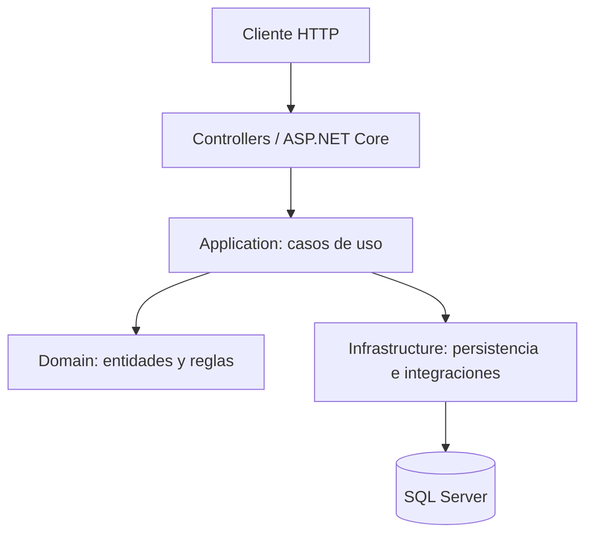

# Arquitectura y decisiones técnicas

## Estilo

G3 Operaciones está organizado como un monolito modular dentro de una aplicación ASP.NET Core. Las carpetas separan responsabilidades, pero comparten el mismo ensamblado y proceso de ejecución.

## Capas

- **Domain:** entidades, estados y reglas fundamentales del negocio.
- **Application:** DTOs, interfaces, validaciones y orquestación de casos de uso.
- **Infrastructure:** EF Core, SQL Server, hashing de contraseñas, generación JWT e integraciones técnicas.
- **Controllers:** adaptadores HTTP, autorización y traducción de solicitudes a casos de uso.

## Persistencia

`ApplicationDbContext` centraliza los conjuntos de entidades y aplica configuraciones Fluent API del ensamblado. Las migraciones EF Core viven en `Migrations/`.

## Dependencias y deuda técnica

La organización es una base modular, no una Clean Architecture estricta: algunos servicios ubicados en Application dependen directamente de `ApplicationDbContext`. Una evolución segura consiste en introducir contratos de persistencia en Application y sus implementaciones en Infrastructure, módulo por módulo y con pruebas de caracterización.

## Decisiones para el MVP

- Mantener un único proyecto para reducir fricción de compilación y despliegue.
- Separar módulos por capacidad de negocio.
- Usar DTOs para contratos HTTP.
- Conservar migraciones para cambios de esquema.
- Evitar introducir infraestructura externa sin necesidad operativa demostrable.

## Diagrama lógico

